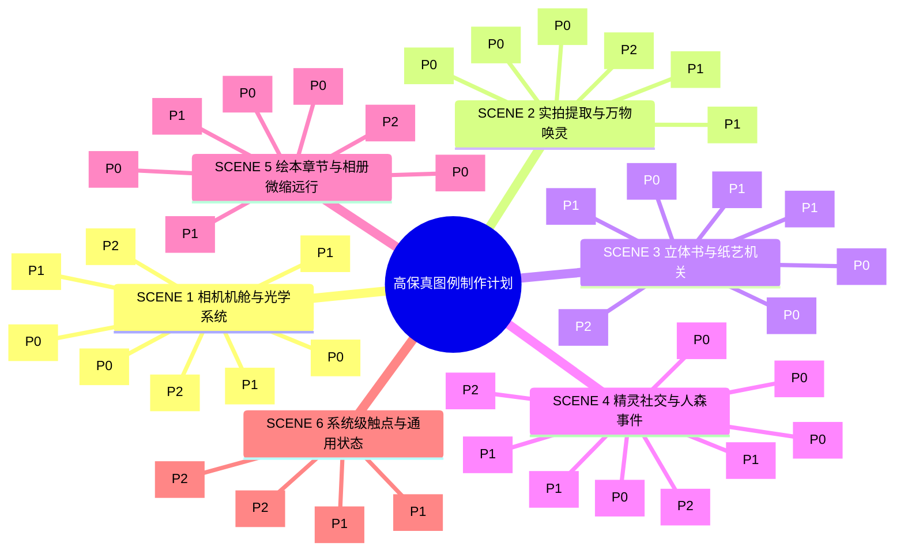

# 《拾光绘本：万物有灵》全场景高保真图例制作与任务派发计划

---

## 一、 计划目标与派发规范

### 1.1 目标定位
本计划旨在将《拾光绘本：万物有灵》GDD（游戏企划设定书）中的全部核心场景、特殊分支与交互状态，转化为可直接指派给 **UI 设计师、2D 手绘插画师、AI 生成工程师、动效设计师及前端开发** 的标准化生产任务卡。补全此前仅聚焦于“基础相机”的局限，覆盖“一机一书”完整生态。

### 1.2 画布规格与设计基准
* **竖屏移动端基准 (Portrait Mobile)**：
  - 设计基准视口：`390 × 844 pt`（iPhone 14/15 逻辑分辨率，安全区 Top 47pt / Bottom 34pt）
  - 高保真图例导出：`1170 × 2532 px`（@3x PNG）或 `1200 × 2600 px`
* **横屏全景基准 (Landscape Viewport)**：
  - 导出规格：`1920 × 1080 px`（16:9 全高清 PNG）
  - 画幅有效区域：支持 `65:24`（XPAN 超宽银幕）、`3:4`、`1:1`、`16:9`
* **独立贴纸与立牌素材 (Sprites & Cutouts)**：
  - 规格：`1024 × 1024 px`（1:1 纯透明背景 PNG，自带手绘模切白边与可折叠纸底脚）
* **视觉语言规范 (Style Guide)**：
  - **相机端**：复古金属质感（炭黑机身、黄铜旋钮、露铜包浆）、光学机械感、写实银盐颗粒。
  - **绘本端**：棉浆水彩纸肌理底纹、针管墨线、低饱和复古水彩晕染、折纸立体卡榫与阴影、手绘表情气泡。规避任何赛博数码塑料感。

### 1.3 工种代号说明
* `[UI]`：界面排版、控件交互、栅格与信息架构设计
* `[ART]`：2D 手绘线稿、纸艺结构、水彩笔触、贴纸插画设计
* `[AI-GEN]`：AI 图像提示词调优、素材采样生成与去背处理
* `[VFX]`：帧动效、纸艺折叠与展开、水彩晕染扩散、粒子纸屑动效
* `[DEV]`：前端 Canvas/CSS3D 还原、手势系统与数据状态机对接

---

## 二、 任务全景矩阵与优先级大纲



---

## 三、 详细任务派发卡 (Task Cards)

### SCENE 1：拟真相机机舱与光学系统 (CAM)

#### 【CAM-01】经典旁轴机舱 - 黄斑裂像与峰值对焦 (Focus Peaking)
* **任务编号**：`CAM-01`
* **优先级**：`P0`（核心机舱体验）
* **责任工种**：`[UI]` `[AI-GEN]`
* **画面规格**：竖屏 `1170 × 2532 px` 与 横屏 `1920 × 1080 px`
* **画面构成与排版**：
  1. 取景框中央显示经典旁轴的双矩形“黄斑裂像”框，合焦时两层重叠影完全重合；
  2. 画面边缘的高对比度轮廓浮现细致的柔白/金黄色“峰值对焦（Focus Peaking）”光斑；
  3. 下沿显示手动对焦距离刻度标尺（如 `0.5m - 1.2m - ∞`）与当前曝光读数；
  4. 画面呈现高质感写实室内景（雨天窗边、木桌台灯）。
* **设计验收指标**：
  - 双影未合焦与合焦两种状态必须有明确的视觉区分；
  - 界面保留复古旁轴机械金属感，不得出现科技感准星。
* **AI 生成 Prompt 模板**：
  ```text
  Use case: photorealistic-natural. A realistic 35mm film photograph taken through the viewfinder of a vintage Leica M rangefinder camera. In the center of the frame is a semi-transparent warm yellow split-image rangefinder patch. The subject is a cozy rainy windowsill with an olive green desk lamp and books. Crisp grain, brass dial elements subtly framing the view, optical natural depth of field. Soft white focus peaking highlights shimmering along the focused edges of the lamp shade. No digital crosshairs, no modern sci-fi HUD.
  ```

---

#### 【CAM-02】复古拍立得机舱 - 出片滑动与摇动显影过程 (Instant Polaroid)
* **任务编号**：`CAM-02`
* **优先级**：`P0`（特色机舱体验）
* **责任工种**：`[UI]` `[ART]` `[VFX]`
* **画面规格**：竖屏 3 联连续关键帧（`1170 × 2532 px × 3`）
* **画面构成与排版**：
  1. **帧 1（按下快门吐纸）**：拍立得机顶出纸口机械动作，白色相纸边框伴随轻微机械声向上弹出 30%；
  2. **帧 2（未显影与摇晃提示）**：相纸完全弹出悬浮在屏幕中央，画面呈灰白乳浊感，屏幕出现手绘摇晃手机的小手图标与文字提示：“摇晃手机加速显影”；
  3. **帧 3（显影完毕成片）**：从中央向边缘逐渐呈现出暖调饱满的真实胶片影像，宽白边相纸下方印有手写体日期与色温色卡。
* **设计验收指标**：
  - 必须呈现从“乳白模糊胶液”到“色彩逐渐饱和清晰”的化学显影质感；
  - 宽白边框要有真实的无光哑面相纸厚度与阴影。
* **AI 生成 Prompt 模板**：
  ```text
  Use case: precise-object-edit. High fidelity product shot of a classic Polaroid instant film photo laying on a flaxen cotton paper surface. The frame is wide bottom white matte cardboard. Inside the frame, the image shows a nostalgic warm film capture of a rainy afternoon coffee cup and lamp, gradual chemical development effect with soft amber tones and creamy highlights. Authentic physical paper drop shadow, warm ambient lighting. No typography, no watermark.
  ```

---

#### 【CAM-03】半格双联机舱 - 电影感拼版叙事 (Half-Frame Diptych)
* **任务编号**：`CAM-03`
* **优先级**：`P0`（叙事型摄影利器）
* **责任工种**：`[UI]` `[AI-GEN]`
* **画面规格**：横屏 `1920 × 1080 px`
* **画面构成与排版**：
  1. 取景框中间由一条带有微小黑色胶片间隙的垂直分割线分为左右两格；
  2. **左格（已冻结第一张）**：拍摄完成的“雨中街角咖啡馆门面”竖幅写实画面，标记小图标“1/2 ✓”；
  3. **右格（实时取景第二张）**：正在取景的“咖啡桌上的拉花拿铁与咖啡勺特写”，右下角显示快门就绪状态“2/2”；
  4. 底部中央印有拟真柯达/富士底片齿孔与帧号标记（如 `EXP 14A` 与 `EXP 15`）。
* **设计验收指标**：
  - 两张画面的竖长比例（约 3:4）视觉协调，强调整体二联画叙事张力；
  - 胶片边缘要有逼真的齿孔与底片黑色保护边。

---

#### 【CAM-04】千禧复古 CCD 机舱 - 直闪冷白皮与像素 UI (Y2K CCD)
* **任务编号**：`CAM-04`
* **优先级**：`P1`（复古潮流风格）
* **责任工种**：`[UI]` `[AI-GEN]`
* **画面规格**：横屏 `1920 × 1080 px`
* **画面构成与排版**：
  1. 界面外框模拟 2004 年日系卡片机银灰色磨砂机身与 2.5 英寸低反差 TFT 液晶屏边框；
  2. 屏幕上方显示像素风电量格、绿色微距小花图标、强闪光灯标志；
  3. 取景内容为夜晚室内人像或黑白猫咪：呈现经典的**千禧硬闪光冷白肤色、中心强光外围暗角、微弱紫边色散（Purple Fringing）与轻微噪点感**；
  4. 右下角压印标志性的亮橙色发光液晶数码日期戳（如 `'04 11 11`）。
* **设计验收指标**：
  - 准确还原千禧年小底 CCD 传感器的闪光灯质感，不过度泛黄，偏向通透冷白皮；
  - 绿色自动对焦锁定方框有 1~2 像素轻微发光。

---

#### 【CAM-05】65:24 XPAN 超宽银幕画幅与双语电影字幕
* **任务编号**：`CAM-05`
* **优先级**：`P1`（高逼格电影摄影）
* **责任工种**：`[UI]` `[AI-GEN]`
* **画面规格**：横屏 `1920 × 1080 px`
* **画面构成与排版**：
  1. 屏幕上下留出浓黑的电影遮罩黑边，中央显露极致宽广的 `65:24` 超宽银幕画面（如海边渡轮码头或纵深长街）；
  2. 画幅四角带有细致的手绘取景白角框线；
  3. 画面下部偏上黑边处，压印优雅居中的双语电影台词风格字幕（白字淡黄描边，如“在时光的缝隙里，万物皆有回响。/ Every object holds an echo of time.”）；
  4. 支持点击切换纯净无黑边导出态。
* **设计验收指标**：
  - 超宽画幅构图极具冲击力，边缘无畸变拉伸；
  - 字幕排版精致，符合文艺艺术电影规范。

---

#### 【CAM-06】五款光学附加镜特效取景 (Optical Attachments)
* **任务编号**：`CAM-06`
* **优先级**：`P1`（摄影趣味扩展）
* **责任工种**：`[UI]` `[ART]` `[AI-GEN]`
* **画面规格**：横屏/竖屏 5 张独立关键效果图
* **画面构成与排版**：
  1. **180° 街头鱼眼镜**：强烈桶形畸变，四周伴随圆形黑边暗角，适合猫狗大头照；
  2. **移轴微缩模型镜（Tilt-Shift）**：俯拍街道，画面上下各 35% 强烈模糊，中央带高饱和玩具感；
  3. **十字星芒镜（Star Filter）**：夜晚路灯、车灯与蜡烛点光源产生放射状四芒/六芒浪漫星光；
  4. **梦幻黑柔焦镜（Black Mist）**：逆光高光边缘溢出柔和电影感光晕，暗部泛起柔润灰调；
  5. **双重曝光拨杆（Double Exposure）**：第一张静物花卉半透明残留在取景器内，引导对准猫咪剪影二次曝光。
* **设计验收指标**：
  - 每款镜片在取景器左上角有可爱的迷你铜环镜头图标标识；
  - 光学效果自然，绝非生硬的数字模糊。

---

#### 【CAM-07】机身自然露铜包浆进阶与配件改装面板
* **任务编号**：`CAM-07`
* **优先级**：`P2`（长期养成荣誉）
* **责任工种**：`[UI]` `[ART]`
* **画面规格**：横屏 `1920 × 1080 px`
* **画面构成与排版**：
  1. **四阶段机身露铜展示**：
     - ① 0~99 次：全新哑光黑漆机身；
     - ② 100 次：快门钮与机顶棱角显露微弱金色铜边；
     - ③ 500 次：手柄握把处与过片扳手大面积磨出温润黄铜色；
     - ④ 1000 次：重度历史包浆，黑色与黄铜交融，机顶刻印“Master Craft”；
  2. **机身改装抽屉**：可拖拽替换胡桃木手柄、复古橄榄绿皮革、红色黄铜快门扣、搪瓷猫爪快门扣。
* **设计验收指标**：
  - 露铜质感写实细腻，体现黑漆金属被手汗和岁月盘磨出的油润感；
  - 改装配件具有明显的手工定制温润质感。

---

#### 【CAM-08】Wigglegram 3D 摇摆立体照与环境留声相纸
* **任务编号**：`CAM-08`
* **优先级**：`P2`（独家创新功能）
* **责任工种**：`[UI]` `[VFX]` `[DEV]`
* **画面规格**：动效 GIF / 序列关键帧（`1170 × 2532 px`）
* **画面构成与排版**：
  1. **Wigglegram 3D 摇摆照**：左-中-右微幅位移连续快速摆动（0.15 秒间隔），背景位移大、前景物体立体感呼之欲出；
  2. **留声相纸**：拍立得成片底部印有一段手绘水彩波形音频包络线，附带“▶ 0:03 雨声白噪音”播放按钮；
  3. **五色温光谱卡**：相纸下边框整齐排列从照片中提取出的 5 颗圆形水彩主色卡，附拍摄时天气与温度。

---

### SCENE 2：实拍提取、餐饮分支与万物唤灵 (STK)

#### 【STK-01】日常器物类贴纸提取全流程 (Sticker Extraction)
* **任务编号**：`STK-01`
* **优先级**：`P0`（绘本核心基石）
* **责任工种**：`[UI]` `[ART]` `[AI-GEN]`
* **画面规格**：竖屏 `1170 × 2532 px` 双栏对比
* **画面构成与排版**：
  1. **左侧**：应用内实拍的原片照片（橄榄绿蘑菇台灯处于居中位置）；
  2. **右侧**：端侧抠图后的绘本贴纸形态——写实材质转化为清透水彩与针管笔墨线，边缘带有一圈精致的 **模切白边（Die-cut Border）** 与微翘纸影；
  3. **底部操作栏**：包含【收入贴纸夹（免费·无限制）】与闪烁微光的【注入灵魂（今日剩余 1/1）】金边大按钮。
* **设计验收指标**：
  - 左右对比必须能看清楚从“写实照片”到“手绘水彩纸艺”的降维概括过程；
  - 严禁在物体上强行画人类手脚和眼睛。
* **AI 生成 Prompt 模板**：
  ```text
  Use case: illustration-story. Single isolated die-cut watercolor sticker of a vintage moss olive green enamel mushroom desk lamp, wide conical curved olive shade with tiny amber brass finial, tapered stem, circular foot. Centered on pure transparent background. Rendered in delicate dry watercolor wash with crisp dark sepia ink contour lines and cotton paper fiber texture. Surrounded by a clean 2mm white die-cut sticker border and a subtle soft paper cast drop shadow. Flat object, no facial features, no limbs, no text. Japanese cozy picture-book style.
  ```

---

#### 【STK-02】餐饮美食与口粮提取分支（双重产出特例）
* **任务编号**：`STK-02`
* **优先级**：`P0`（日常三餐核心循环）
* **责任工种**：`[UI]` `[ART]`
* **画面规格**：竖屏 `1170 × 2532 px`
* **画面构成与排版**：
  1. 拍摄对象为实拍美食（如一块焦糖巴斯克蛋糕与一杯拿铁）；
  2. 提取界面明确提示：“检测到美味餐饮：食物不可唤灵，但蕴含治愈灵气！”；
  3. **双重产出动画展示**：
     - 产出 ①：【永久美食装饰贴纸 × 1】（精致手绘白边蛋糕，可摆在书房桌上）；
     - 产出 ②：【消耗型美食口粮 × 1】（落入右下角背包口粮袋，显示 `+1 份巴斯克`）；
  4. 界面无【注入灵魂】按钮，替换为【收入口粮包】与【摆入立体书】。
* **设计验收指标**：
  - 明确区分“装饰贴纸”与“消耗口粮”的视觉标识；
  - 手绘美食色彩鲜亮诱人，具备油画棒/高显色水彩质感。

---

#### 【STK-03】整景画布转背景墙纸分支
* **任务编号**：`STK-03`
* **优先级**：`P1`（大场景装修）
* **责任工种**：`[UI]` `[AI-GEN]`
* **画面规格**：横屏 `1920 × 1080 px`
* **画面构成与排版**：
  1. 玩家拍摄街景、窗景或房间全貌照片，在暗房中勾选【整图转为背景墙】；
  2. 画面呈现整张风景从写实胶片被“水彩刷子”从左至右涂刷为大面积绘本插画的过程；
  3. 展示立体书跨页背景墙替换前后的对比效果（黑白书页背景墙贴上了自制的水彩窗景）。

---

#### 【STK-04】每日 1 次【注入灵魂】唤醒仪式关键序列
* **任务编号**：`STK-04`
* **优先级**：`P0`（最具情感份量的一刻）
* **责任工种**：`[UI]` `[ART]` `[VFX]`
* **画面规格**：竖屏 4 联序列图（`1170 × 2532 px × 4`）
* **画面构成与排版**：
  1. **步骤 1（消耗印记）**：一枚金色的【唤灵印章】重重盖在贴纸右下方，纸面震颤；
  2. **步骤 2（五维汇聚）**：从印章处向贴纸汇入五色光流（代表物种、胶片性格、时间、天气、相性）；
  3. **步骤 3（立牌成型）**：贴纸底部向后折叠出白卡纸质三角支撑脚，纸偶立牌在书桌上“站立”起来；
  4. **步骤 4（初次苏醒）**：立牌轻快原地跳跃一下，头顶冒出闪亮的大爱心表情气泡 `❤️`，右侧滑出精灵初始档案（如“阿灯 · 光电族 · 暖阳社牛性格”），今日印记变为 `0/1`。
* **设计验收指标**：
  - 必须清晰展现从“平铺贴纸”到“拥有折纸脚、立在空间中”的物理立体转变；
  - 诞生动效神圣且温暖，有开箱的惊喜感。
* **AI 生成 Prompt 模板**：
  ```text
  Use case: illustration-story. A miniature pop-up paper standee of the olive green mushroom desk lamp standing upright on a warm paper surface. At the lamp's base, a small white cardstock folded triangular support and one flat card foot are visibly attached, giving it the physical structure of a paper doll. The lamp is hopping slightly with joyful motion blur, casting a soft ambient drop shadow. A hand-drawn red heart emoticon bubble pops above the lamp. No eyes or mouth on the lamp, pure watercolor tactile paper craft style.
  ```

---

#### 【STK-05】精灵一星至四星升星成长图谱
* **任务编号**：`STK-05`
* **优先级**：`P1`（长线养成视觉反馈）
* **责任工种**：`[UI]` `[ART]`
* **画面规格**：横屏 `1920 × 1080 px` 四形态对照
* **画面构成与排版**：
  1. **⭐ 一星·初醒**：基础白卡折纸底座，简单手绘表情气泡，白卡纸边缘；
  2. **⭐⭐ 二星·通灵**：升级为厚实复古牛皮纸底座，立牌旁出现飘浮的【伴生天气小雨云纸片】；
  3. **⭐⭐⭐ 三星·拾光**：贴纸模切白边升级为**烫金镭射反光边框**，立牌可左右歪头大幅晃动；
  4. **⭐⭐⭐⭐ 四星·万灵**：立牌周围常驻一层柔和的水彩手绘光晕，落脚点带有专属金色星形邮戳底盘。
* **设计验收指标**：
  - 四档进阶材质区分明显，荣誉感层层递进；
  - 角色依然保持物品本体，不增加人造肢体。

---

### SCENE 3：立体折叠书剧场与纸艺机关 (POP)

#### 【POP-01】90°/180° 立体书开合翻页关键帧 (Pop-up Book Opening)
* **任务编号**：`POP-01`
* **优先级**：`P0`（核心世界容器）
* **责任工种**：`[ART]` `[VFX]` `[DEV]`
* **画面规格**：横屏 3 联连续关键帧（`1920 × 1080 px × 3`）
* **画面构成与排版**：
  1. **关键帧 1（半开 45°）**：双手从屏幕两侧翻开书页，书本中央折痕处的背景立面正随着纸铰链缓缓升起；
  2. **关键帧 2（直立 90°）**：背景墙直立锁定，二层阁楼卡榫弹开，前景台面水平铺展，露出地面的纸槽导轨；
  3. **关键帧 3（完全平摊 180°）**：整本立体书完全摊平在深胡桃木书桌上，厚重的书脊向外自然弯曲，精灵立牌稳稳立在轨道上。
* **设计验收指标**：
  - 必须准确表现真实立体折纸贺卡/弹出书（Pop-up Book）的物理联动折线与卡扣；
  - 纸张的厚度感、折痕白边和投影要极其自然。
* **AI 生成 Prompt 模板**：
  ```text
  Use case: illustration-story. Wide 16:9 landscape view of a hand-crafted pop-up book diorama room, opened at a 90-degree angle on a dark walnut table. The vertical rear paper wall pops up along the center binding fold, joined with the flat bottom paper page. Crisp black ink line art on heavy warm off-white cotton watercolor paper, showing visible slotted cardboard hinges, folded paper tabs, and soft cast shadows. The room has a slotted reading loft and tiny pull-tab paper window. Tactile museum-grade paper sculpture feel, completely clean of text or modern digital UI.
  ```

---

#### 【POP-02】三大书页空间氛围演化与页边涂鸦自然生长
* **任务编号**：`POP-02`
* **优先级**：`P0`（高自由度生态）
* **责任工种**：`[ART]` `[AI-GEN]`
* **画面规格**：横屏 3 张独立全景图（`1920 × 1080 px × 3`）
* **画面构成与排版**：
  1. **氛围 A【深夜自习室】**：
     - 摆放台灯、书本、钢笔、眼镜贴纸；
     - 四周空白纸边自然生长出：深棕色咖啡杯圆印渍、手绘曲别针便签、深夜星月涂鸦、夜行精灵聚集。
  2. **氛围 B【午后甜品屋】**：
     - 摆放咖啡杯、巴斯克蛋糕、木质桌椅、小碎花贴纸；
     - 页边生长出：手绘格子桌布花边、散落的方糖与小勺子简笔涂鸦、暖黄柔和光晕。
  3. **氛围 C【阳光植物园】**：
     - 摆放多肉、蕨类盆栽、洒水壶、透明玻璃瓶贴纸；
     - 页边生长出：绿色水彩藤蔓缠绕书脊、手绘叶脉书签印章、微风飘落小树叶纸片。
* **设计验收指标**：
  - 氛围并非生硬换皮，而是由所摆贴纸自然催化产生；
  - 页边涂鸦（Margin Doodles）与中央场景形成和谐的手帐一体感。

---

#### 【POP-03】黑白底稿与水彩贴纸落位水彩晕染扩散过程
* **任务编号**：`POP-03`
* **优先级**：`P0`（核心治愈心流）
* **责任工种**：`[ART]` `[VFX]`
* **画面规格**：横屏 3 联阶段对照（`1920 × 1080 px × 3`）
* **画面构成与排版**：
  1. **阶段 1（纯黑白底稿）**：整页立体书完全由黑白针管笔线稿与浅灰纸模阴影构成，没有丝毫颜色；
  2. **阶段 2（贴纸落位与局部晕染）**：将一张彩色台灯精灵摆在左侧轨道，以其底座为圆心，周围 30% 的黑白纸面与背景墙被温柔晕染出透明暖橙色水彩湿画效果；
  3. **阶段 3（60% 全彩点亮）**：随着更多精灵与家具摆入，彩色水彩连成一片，右上角解锁金色的【全彩点亮机关印章】，点击可切换全彩/素描模式。
* **设计验收指标**：
  - 水彩晕染要有真实的边缘湿渗效果（Wet-on-dry bloom）与棉浆纸纹；
  - 彩色与黑白交界处自然柔和，绝无生硬色块切边。

---

#### 【POP-04】纸艺扩建：二层小阁楼与飘窗夹层 (Paper Loft Upgrade)
* **任务编号**：`POP-04`
* **优先级**：`P1`（空间扩容与动线丰富）
* **责任工种**：`[ART]` `[UI]`
* **画面规格**：横屏 `1920 × 1080 px`
* **画面构成与排版**：
  1. 消耗【灵感露水】后，背景立面折叠出一座带细纸梯的**二层挑高小阁楼**；
  2. 画面展示单页容量从 4 只扩展为 8 只精灵立牌；
  3. 精灵可通过纸梯在上下层之间蹦跳巡逻，小精灵可趴在二层栏杆向下探头冒问好气泡。

---

#### 【POP-05】可动纸艺机关：开合窗拉条 (Pull-tab Window)
* **任务编号**：`POP-05`
* **优先级**：`P1`（可动触感玩具）
* **责任工种**：`[ART]` `[VFX]` `[DEV]`
* **画面规格**：横屏 2 联动作对比
* **画面构成与排版**：
  1. 立体书背景墙带有一扇活动纸窗，书页右边缘露出一枚标有手绘箭头的牛皮纸拉条（Pull-tab）；
  2. 手指按住向右拉出时，纸窗百叶被联动拉开，窗外透进当前现实时间的暖光或雨滴音效；
  3. 精灵立牌会转头看向拉开的窗户，头顶冒出惊叹气泡 `✨`。

---

#### 【POP-06】可动纸艺机关：昼夜旋转纸盘 (Spinning Sky Wheel)
* **任务编号**：`POP-06`
* **优先级**：`P1`（时间氛围切换）
* **责任工种**：`[ART]` `[DEV]`
* **画面规格**：横屏特写与全景结合
* **画面构成与排版**：
  1. 书页右上角装配有一枚露出一半齿轮边缘的双层圆形旋转纸盘（Sky Wheel）；
  2. 手指拨动旋转时，背景镂空圆窗中顺次轮播：**【清晨微曦】→【午后暖阳】→【金黄落日】→【深蓝繁星】**；
  3. 切换至星夜时，台灯精灵亮起温暖暖光，夜行性精灵从睡梦中苏醒。

---

### SCENE 4：“人森/动森”式精灵社交与气泡互动 (SOC)

#### 【SOC-01】欢喜冤家冷战背对背与【美食口粮】甜点劝架全流程
* **任务编号**：`SOC-01`
* **优先级**：`P0`（人森抓马灵魂）
* **责任工种**：`[UI]` `[ART]` `[VFX]`
* **画面规格**：横屏 3 联情景连续图（`1920 × 1080 px × 3`）
* **画面构成与排版**：
  1. **情景 1（冷战背对背）**：台灯精灵与仙人掌精灵背对背站着，立牌微微颤抖，头顶各冒出一团手绘赌气黑线与感叹号 `💢`，谁也不理谁；
  2. **情景 2（放置甜点劝架）**：玩家从背包拖拽出一份【实拍巴斯克蛋糕口粮】，放在两只精灵中间的地面纸槽上；
  3. **情景 3（破冰和好）**：两只精灵同时转身，小步蹦跳凑到蛋糕两旁分吃，头顶黑线化作旋转的小粉心 `💕` 与和好音符 `🎵`，亲密度条暴涨。
* **设计验收指标**：
  - 精灵肢体动作（背对背、歪头、蹭过去）诙谐生动，重现《朋友收集》精髓；
  - 劝架机制与实拍美食口粮完美闭环。

---

#### 【SOC-02】死党合体动作与日常萌趣交互
* **任务编号**：`SOC-02`
* **优先级**：`P1`（羁绊达成荣誉）
* **责任工种**：`[ART]`
* **画面规格**：竖屏/横屏 3 组特写插画
* **画面构成与排版**：
  1. **合体 1**：小咖啡勺精灵整只跳进马克杯精灵肚子里，露出小勺柄前后摇晃；
  2. **合体 2**：迷你多肉立牌跳到台灯宽大的圆形底座上，借助台灯的暖光“取暖光合作用”；
  3. **合体 3**：两只精灵头顶并排冒出同色调的双联音符，步调一致在轨道上跳兔子舞。

---

#### 【SOC-03】奇葩同好会围坐茶话会（反向观察主人吐槽大会）
* **任务编号**：`SOC-03`
* **优先级**：`P0`（爆笑破壁体验）
* **责任工种**：`[UI]` `[ART]`
* **画面规格**：横屏 `1920 × 1080 px`
* **画面构成与排版**：
  1. 3~4 只精灵立牌围坐在一张实拍木茶几贴纸周围，中央飘着一颗绿色【同好会群聊茶杯泡 `🍵`】；
  2. 点击气泡后镜头推近，弹出一张手绘对话框剧场：
     - 马克杯：“据本杯统计，主人这周用美食胶片拍了 4 次深夜烧烤，建议列入重点关怀名单！”
     - 阿灯：“附议！而且每次拍完都忘记擦镜头，害我反光都是油的！”
     - 仙人掌：“（默默冒发呆汗滴……）”
  3. 对话由玩家近期真实的拍摄数据动态驱动。

---

#### 【SOC-04】橙色烦恼求助气泡与三选一建议交友助攻
* **任务编号**：`SOC-04`
* **优先级**：`P0`（人森助攻交互）
* **责任工种**：`[UI]` `[ART]`
* **画面规格**：横屏/竖屏各 1 稿（参考横屏 B08）
* **画面构成与排版**：
  1. 某只精灵头顶冒出不断弹跳的【橙色感叹烦恼泡 `💬`】；
  2. 点击后进入专属对话幕布，精灵向玩家倾诉：“我想和隔壁新搬来的仙人掌打招呼，但它看起来好凶，我该怎么办？”；
  3. 底部纸页弹出三条手绘选项建议：
     - ① 推荐建议：“送它一捧刚拍到的清晨露水贴纸！”
     - ② 搞笑建议：“直接开最强强光把它照晕！”
     - ③ 佛系建议：“在它旁边打个瞌睡，假装偶遇。”
  4. 选完后立即现场演练交友结果动画。

---

#### 【SOC-05】彩色云朵白日梦纸偶剧场
* **任务编号**：`SOC-05`
* **优先级**：`P1`（神秘梦境收藏）
* **责任工种**：`[ART]` `[VFX]`
* **画面规格**：横屏 `1920 × 1080 px`
* **画面构成与排版**：
  1. 打瞌睡的精灵头顶冒出柔和变色的【彩色云朵泡 `💭`】；
  2. 点击后，立体书拉下一幅半透明的皮影戏折纸幕布，上演 15 秒荒诞手绘纸偶戏（如阿灯梦见自己变成了宇宙飞船，载着马克杯飞向红外胶片星空）；
  3. 梦境结束后，幕布折角掉落一枚稀有的【梦境涂鸦纪念贴纸】可收录进图鉴。

---

#### 【SOC-06】本命美食口味盲盒与夸张【螺旋升天庆典】
* **任务编号**：`SOC-06`
* **优先级**：`P0`（情绪价值峰值）
* **责任工种**：`[ART]` `[VFX]`
* **画面规格**：竖屏 3 联特效分解图
* **画面构成与排版**：
  1. **喂中普通食物**：立牌咀嚼两下，冒出小开心音符，增加基础经验；
  2. **喂中本命至爱美食（触发升天）**：
     - 整个书页背景瞬间化为极简淡彩素描，四周炸开无数手绘彩色纸带与五彩纸屑粒子；
     - 精灵立牌像《朋友收集》一样**两眼冒爱心、原地高速螺旋升天 360° 转圈**；
     - 屏幕中央弹出金色大字“【本命至爱！】”，暴吐双倍灵感露水，图鉴档案永久盖上美食大印章。

---

### SCENE 5：绘本四大章节、暗房与相册远行 (TAB)

#### 【TAB-01】扉页《拾光小报》（八卦早报/晚报）
* **任务编号**：`TAB-01`
* **优先级**：`P0`（每日登录第一眼）
* **责任工种**：`[UI]` `[ART]`
* **画面规格**：横屏 `1920 × 1080 px`
* **画面构成与排版**：
  1. 翻开绘本封面，映入眼帘的是夹在扉页里的发黄折叠报纸——《拾光小报 第 042 期》；
  2. **头条大图**：手绘插画抓拍昨晚发生的抓马事件（如两只精灵背对背吵架），配大标题“惊爆！深夜自习室因台灯站位引发冷战，神秘蛋糕现身紧急调停！”；
  3. **右侧专栏**：气象占卜、今日快门运势（如“宜拍植物，大吉”）；
  4. **交互控件**：带有手绘虚线与小剪刀图标，点击【一键剪报】可将头条整块剪下收进剪报夹。

---

#### 【TAB-02】标签一：专属相册与无损暗房修图
* **任务编号**：`TAB-02`
* **优先级**：`P0`（摄影后期工具）
* **责任工种**：`[UI]`
* **画面规格**：横屏 `1920 × 1080 px`（参考横屏 B02、B03）
* **画面构成与排版**：
  1. **左页**：应用内相机实拍的全部胶卷网格缩略图，顶部带月份与胶卷分类筛选；
  2. **右页**：当前选中的高质感原片详情，显示拍摄参数（胶片预设、等效焦段、快门时间、天气）；
  3. **无损暗房操作栏**：
     - ① 无损换胶卷 LUT 配方；
     - ② 重新拖动/缩放“半写实半绘本”混拍圆形遮罩；
     - ③ 提供手绘荧光水彩笔与和纸胶带工具，在相纸上自由圈画涂鸦；
     - ④ 核心按钮【提取绘本贴纸】。

---

#### 【TAB-03】标签三：双页图鉴与万物关系连线图
* **任务编号**：`TAB-03`
* **优先级**：`P1`（全收集指南）
* **责任工种**：`[UI]` `[ART]`
* **画面规格**：横屏 `1920 × 1080 px`
* **画面构成与排版**：
  1. **左页【万物贴纸图鉴】**：
     - 摆放已收录的物品贴纸，长按可查看写实原片对比；
     - 下方收纳该词条历史拍过的多张变体照片相册，可点击切换立牌贴纸皮肤。
  2. **右页【精灵档案与关系折页】**：
     - 记录当前精灵的星级、族群、性格、已解锁的本命美食印章；
     - 掀开纸质折页，展开一张手绘的**【万物关系网络图】**，用红虚线连着死党、蓝折线连着欢喜冤家、绿色虚线连着同好会成员。

---

#### 【TAB-04】标签四：相册微缩远行行囊准备与死党偷钻行囊
* **任务编号**：`TAB-04`
* **优先级**：`P0`（情感深度体验）
* **责任工种**：`[UI]` `[ART]`
* **画面规格**：横屏 `1920 × 1080 px`
* **画面构成与排版**：
  1. **目的地挑选**：从专属相册中挑选一张过往拍下的老照片（如上周去过的旧渡轮码头）；
  2. **整理行囊**：展开牛皮纸背包插袋，放入 1 份或 2 份美食口粮便当；
  3. **选择同行伙伴**：单人出发或指定一对死党结伴；
  4. **突发奇遇瞬间（死党偷钻行囊）**：当只派阿灯出发时，它的跟屁虫死党小多肉顺着书签丝带“嗖”地一声钻进行囊露出半个头，画面提示：“仙人掌偷偷跟去了！”。

---

#### 【TAB-05】双人微缩远行归来明信片与重游手记
* **任务编号**：`TAB-05`
* **优先级**：`P0`（远行治愈高光）
* **责任工种**：`[UI]` `[ART]` `[AI-GEN]`
* **画面规格**：横屏 `1920 × 1080 px`（参考横屏 B12）
* **画面构成与排版**：
  1. **左页（绘本明信片）**：
     - 背景是玩家当初拍下的真实渡轮码头木栈道与大海写实照片；
     - 前景木地板上，台灯精灵与仙人掌精灵两只折纸立牌并排立在栏杆旁，地上带有逼真的纸影；
     - 右下角压印一枚本次旅行专属的双人纪念邮戳。
  2. **右页（双视角重游日记与伴手礼）**：
     - 阿灯日记：“今天和多肉去了主人上周去过的海边，木头栏杆有咸咸的海风味道……”；
     - 多肉日记：“台灯差点掉进水里，被我用刺勾住了，好险好险！”；
     - 伴手礼插袋：获得【LUT 调色碎片 × 2】与【海风干花书签】。
* **AI 生成 Prompt 模板**：
  ```text
  Use case: illustration-story. Landscape 3:2 miniature travel postcard artwork. A warm nostalgic 35mm film photograph of an old seaside ferry pier with wooden decking, green timber shelter, calm pale teal sea. In the lower center foreground, two miniature watercolor die-cut paper standees with white outlines are visiting: an olive green mushroom desk lamp and a tiny terracotta potted succulent. Realistic folded paper feet and dimensional cast shadows on the wooden decking boards. Charming contrast between real-life analog photography and hand-painted paper figures. No text, no watermark.
  ```

---

#### 【TAB-06】绘本装帧与“肉眼可见越养越厚”实体手感
* **任务编号**：`TAB-06`
* **优先级**：`P2`（厚重陪伴感）
* **责任工种**：`[ART]`
* **画面规格**：横屏 3 状态对比
* **画面构成与排版**：
  1. **初期（第 1 天）**：绘本合上时薄薄平整，仅有几片纸页；
  2. **中期（第 30 天）**：收集了 20+ 精灵与多张明信片，书脊鼓起，书页缝隙露出一两张露头的明信片与书签；
  3. **后期（第 100 天）**：书脊被塞得鼓鼓囊囊，扎着手织亚麻绑带，侧边参差不齐露出彩色和纸胶带折角、干花书签、拍立得底片与小报剪报边。

---

### SCENE 6：系统级触点与通用状态 (SYS)

#### 【SYS-01】手机桌面 2×2 / 2×4 互动小组件 (Desktop Widgets)
* **任务编号**：`SYS-01`
* **优先级**：`P1`（系统级长线留存）
* **责任工种**：`[UI]` `[ART]`
* **画面规格**：手机主屏界面效果图（包含 2×2 方形与 2×4 长形组件）
* **画面构成与排版**：
  1. **2×2 小组件【今日拍立得 & 精灵值班】**：
     - 白底拍立得相框中轮播玩家用原相机拍出的大片；
     - 当前选派的值班精灵立牌趴在相框上边缘，根据现实天气做表情（下雨天头顶撑起一片小荷叶打伞，冒出雨滴表情）；
  2. **2×4 大组件【立体书小剧场一瞥】**：
     - 缩小版横幅展示立体书当前状态，显示今日《拾光小报》头条摘要与【注入灵魂就绪】提醒。

---

#### 【SYS-02】锁屏秒开纯净相机与系统相册双存
* **任务编号**：`SYS-02`
* **优先级**：`P1`（专业工具属性）
* **责任工种**：`[UI]`
* **画面规格**：锁屏界面 + 手机系统相册效果
* **画面构成与排版**：
  1. **锁屏秒开**：通过 iPhone Action Button 或安卓快捷手势唤醒，0.3 秒跳过任何商业游戏启动屏，直接进入黑金极简旁轴取景器；
  2. **系统相册双存**：拍完打开 iOS/Android 系统相册，整齐排列两张成片：一张是无瑕疵的高分辨率原片（方便发小红书），另一张是带有精美纸纹边框与相机水印的拍立得图。

---

#### 【SYS-03】全局空状态、弱网与权限引导手绘弹窗
* **任务编号**：`SYS-03`
* **优先级**：`P2`（健壮性设计）
* **责任工种**：`[UI]` `[ART]`
* **画面规格**：组件库集合图（6 枚弹窗与空状态卡片）
* **画面构成与排版**：
  1. **空相册状态**：一只手绘的小相机张大嘴巴，配文：“胶卷还是空的呢，快去窗边按下第一次快门吧！”；
  2. **空剧场状态**：空荡荡的黑白折纸房间，地上有一根手绘小问号插签：“还没有室友入住，挑选心爱的物件注入灵魂吧！”；
  3. **相机/麦克风权限弹窗**：模仿老式纸质相机说明书附卡风格，用温暖墨线邀请授权，坚决摒弃生硬的系统原生灰白弹窗。

---

## 四、 任务执行计划与派发排期表

按三阶段推进制作与验收，建议以 **周 (Sprint)** 为单位推进：

| 阶段 / 周期 | 核心交付里程碑 | 涉及任务卡编号 | 核心交付物形态 | 评审验收重点 |
| :--- | :--- | :--- | :--- | :--- |
| **第一阶段 (Sprint 1-2)<br>相机与贴纸闭环** | **MVP 高保真图例与素材打样** | `CAM-01` ~ `CAM-05`<br>`STK-01` ~ `STK-04`<br>`TAB-02` | 10 张核心横/竖屏图例<br>4 组贴纸与立牌透明 PNG<br>AI 提示词标准集 | 确保写实胶片成片与手绘水彩贴纸在同一视觉体系下不突兀，验证 0.3 秒工具感与唤灵仪式感。 |
| **第二阶段 (Sprint 3-4)<br>立体书与社交剧场** | **Alpha 立体书生态全景** | `POP-01` ~ `POP-04`<br>`SOC-01`, `SOC-03`<br>`SOC-04`, `SOC-07`<br>`TAB-01` | 8 张立体书机关全景图<br>6 组人森社交抓马关键帧<br>《拾光小报》排版规范稿 | 确保 90°/180° 折纸机关结构物理合理，验证黑白底稿+水彩局部晕染效果与甜点劝架/升天反馈喜剧感。 |
| **第三阶段 (Sprint 5-6)<br>微缩远行与系统触点** | **Beta 完整沉浸全生态** | `POP-05` ~ `POP-07`<br>`SOC-02`, `SOC-05`<br>`TAB-03` ~ `TAB-06`<br>`CAM-06` ~ `CAM-08`<br>`SYS-01` ~ `SYS-03` | 12 张远行明信片与机关细节图<br>桌面小组件与锁屏全案<br>全局空状态与异常组件库 | 验证旧照片双人远行明信片的情感共鸣，完成全流程 48 个图例节点的任务闭环与切图派发。 |

---

## 五、 素材制作与验收工作流 (Workflow & Checklist)

每个任务卡在派发给具体成员时，严格遵循以下 **4 步验收闭环**：

```text
[1. 需求拆解与 Prompt 调试] 
       ↓ (AI 生成基础底图 / UI 线框图排版)
[2. 视觉一致性核验 (Checklist)]
       - 材质：是否具备纯正的棉浆纸纹、针管笔墨线或经典胶片颗粒？
       - 角色：立牌底座是否清晰？是否严格规避了在物品上强行画五官手脚？
       - 空间：立体书折痕与透视是否满足 90°/180° 折纸联动规律？
       ↓ (通过)
[3. 界面合成与中文精细排版]
       - 填入符合人森/动森轻喜剧调性的文案与读数；
       - 导出标准分辨率切图 (@3x PNG、1:1 透明 WebP)。
       ↓ (交付)
[4. 归档与开发对接]
       - 录入工程对应场景目录并更新图例索引。
```

> **备注**：本计划已完整同步归档于项目仓库，对应任务编号可直接作为 Git Commit、任务管理看板（Jira / Linear / Trello / 飞书项目）的 Issue 标题与派发卡片。
